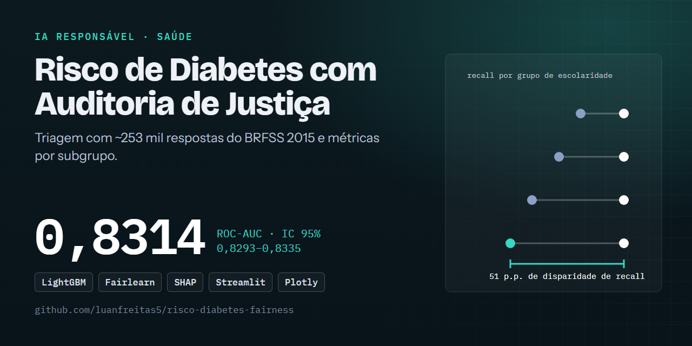
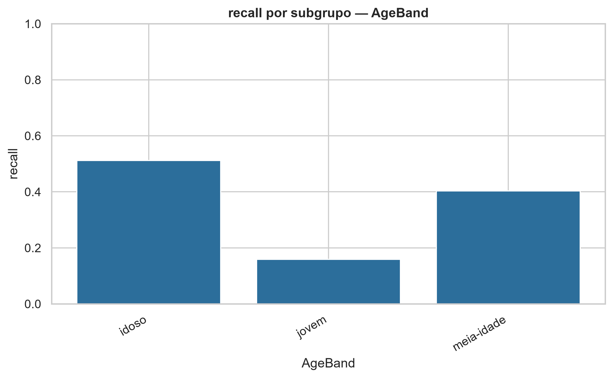

# 🩺 Risco de Diabetes com Auditoria de Justiça: AUC 0,83, mas com recall desigual entre subgrupos

[](https://github.com/luanfreitas5/risco-diabetes-fairness/actions/workflows/ci.yml)
[](https://codecov.io/gh/luanfreitas5/risco-diabetes-fairness)
[](https://luanfreitas5.github.io/risco-diabetes-fairness/)
[](LICENSE)
 <!-- = matriz do CI (tests.yml) -->

> **Resultado:** o LightGBM calibrado atinge ROC-AUC = **0,8314 (IC 95%: 0,8293–0,8335)** na validação cruzada, contra **0,8240 (0,8222–0,8258)** da Regressão Logística, em 253.680 respostas do BRFSS 2015. O ganho é de ~0,007 de AUC e o recall por subgrupo é bem desigual (jovens: 0,16; idosos: 0,51), então o modelo serve para estudar fairness, **não** para decisões clínicas.

> ⚠️ Projeto **educacional / de portfólio**. Não é diagnóstico nem dispositivo médico.



## 🎯 Problema

- **Quem decide o quê:** em um cenário hipotético de triagem, uma equipe de saúde decide quem encaminhar para exame confirmatório (glicemia/HbA1c) a partir de fatores de risco autorreportados.
- **Custo dos erros:** o falso negativo (não sinalizar quem tem diabetes) é mais custoso que o falso positivo (um exame desnecessário) → **métrica principal: ROC-AUC** para selecionar modelos sem depender de limiar, com **PR-AUC** (prevalência de ~14%), **recall/precisão** no limiar operacional de 0,30 e **Brier** (calibração) como co-métricas.
- **Unidade de predição e momento `t0`:** uma linha por respondente; **estudo transversal** — preditores e alvo são medidos na mesma entrevista, então o modelo estima associação com a condição atual, **não** prevê diabetes futuro.

## 🗂️ Dados

| Item | Valor |
|---|---|
| Fonte e licença | [CDC BRFSS 2015](https://www.cdc.gov/brfss/) via [Kaggle](https://www.kaggle.com/datasets/alexteboul/diabetes-health-indicators-dataset) — BRFSS é domínio público; confira a licença do recorte no Kaggle antes de redistribuir |
| Tamanho / período | 253.680 respostas × 21 preditores, 2015 |
| Alvo e prevalência | `Diabetes_binary` (diabetes ou pré-diabetes autorreportado), 13,93% positivos |
| Arquitetura | medalhão em `data/`: **bronze** (CSV imutável + manifest) → **silver** (parquet validado, sem duplicatas) → **gold** (features + `AgeBand`) |
| Documentação | [Datasheet](reports/datasheets/datasheet.md) |

## 📊 Resultados

Protocolo: split estratificado 60/20/20 (treino/validação/holdout), seed 42; validação cruzada estratificada de 5 folds no treino. IC 95% = 1,96·σ/√5 sobre os scores dos folds (aproximação normal com apenas 5 folds, portanto aproximada). As métricas de holdout são pontuais: **ainda sem IC** (bootstrap pendente).

| Modelo | ROC-AUC CV (IC 95%) | ROC-AUC holdout | PR-AUC holdout |
|---|---|---|---|
| Baseline: Regressão Logística | 0,8240 ± 0,0018 | não avaliado | não avaliado |
| LightGBM calibrado (isotônica) | **0,8314 ± 0,0021** | 0,8272 | 0,4235 |

No holdout, com limiar 0,30: recall 0,469, precisão 0,432, F1 0,450, acurácia balanceada 0,685, Brier 0,0973.

- **Diferença vs baseline:** +0,0074 de AUC na CV; os ICs não se sobrepõem, mas **o teste formal de significância (t reamostrado corrigido) ainda não foi feito**, então não afirmamos que um é "melhor" com confiança.
- **Pior segmento:** jovens (18–39) com recall de **0,159**; também há queda em renda (nível 8: 0,285) e escolaridade (nível 6: 0,349) mais altas. Diferença máxima de recall: idade 0,35, renda 0,37, escolaridade 0,51; por sexo, 0,008 (ver [Model Card](reports/model_cards/model_card.md)).
- **Variáveis mais importantes (SHAP):** saúde geral percebida (`GenHlth`), idade, IMC, hipertensão e colesterol alto.



Todos os números vêm de [`holdout_metrics.json`](reports/metrics/holdout_metrics.json), [`training_summary.json`](reports/metrics/training_summary.json), [`fairness_report.json`](reports/metrics/fairness_report.json) e [`shap_importance.json`](reports/metrics/shap_importance.json). Outras figuras estão em [`reports/figures/`](reports/figures/) (ROC, PR, calibração, SHAP, fairness).

## 🔁 Reproduzir

Requisitos: [uv](https://docs.astral.sh/uv/), `make` e o CSV `diabetes_binary_health_indicators_BRFSS2015.csv` do [Kaggle](https://www.kaggle.com/datasets/alexteboul/diabetes-health-indicators-dataset) em `data/bronze/` (download manual). Treino com MLflow exige árvore Git limpa. Tempo: `TODO(owner): medir` (CPU).

```bash
git clone https://github.com/luanfreitas5/risco-diabetes-fairness.git
cd risco-diabetes-fairness
# coloque o CSV em data/bronze/ antes de continuar
```

<!-- verify:start -->
```bash
uv sync --locked --all-groups --no-group profiling
make pipeline   # preprocess (bronze→silver→gold), train, evaluate e audit
```
<!-- verify:end -->

Saída esperada: `roc_auc=0.8272` no holdout (`reports/metrics/holdout_metrics.json`) e `roc_auc: 0.8314 ± 0.0021 (IC 95%)` na CV. Os números publicados foram gerados antes da integração com o MLflow, e a versão do Python e o commit do `uv.lock` que os produziram não foram registrados: `TODO(owner): rodar make pipeline em Python 3.12, registrar versão e SHA e confirmar os valores`.

Extras:

```bash
make mlflow-ui    # compara os runs (SQLite em mlruns/mlflow.db), http://127.0.0.1:5000
make install-app && make app   # dashboard Streamlit
make docker-up    # dashboard em container (+ MLflow com --profile tracking)
make check        # replica o CI: lint, tipos, segurança, qualidade e testes (>= 80%)
```

## 🧱 Estrutura

```
├── configs/        # YAML validados por Pydantic (config, paths, logging, model_params, deploy)
├── data/           # bronze/ (imutável) → silver/ → gold/   (fora do Git)
├── src/            # pacotes por funcionalidade: data, schemas, features, models, evaluation,
│                   # fairness, explainability, experiment (MLflow), pipelines, main.py
├── app/            # dashboard Streamlit
├── tests/          # unitários, property-based e comportamentais
├── reports/        # figures/, metrics/ (JSON), model_cards/, datasheets/
├── docker/         # Dockerfile do servidor MLflow
└── docs/           # MkDocs Material
```

## ⚠️ Limitações

- **Disparidade de desempenho:** o recall cai muito em jovens, renda e escolaridade altas; nenhuma mitigação foi aplicada ainda.
- **Recall baixo (0,47) no limiar 0,30:** mais da metade dos casos não é sinalizada.
- **Rótulo autorreportado, estudo transversal e dados de 2015 (EUA):** sem validação externa nem para a população brasileira; sem pesos amostrais, não estima prevalência.
- **Incerteza incompleta:** holdout sem IC, sem teste de significância vs baseline e sem IC por subgrupo (`n` por grupo pendente).
- **Aproximação do IC:** só 5 folds, com 1,96·σ/√5.

## 📄 Licença e citação

MIT — ver [LICENSE](LICENSE). Documentos de IA responsável: [Model Card](reports/model_cards/model_card.md) e [Datasheet](reports/datasheets/datasheet.md).
